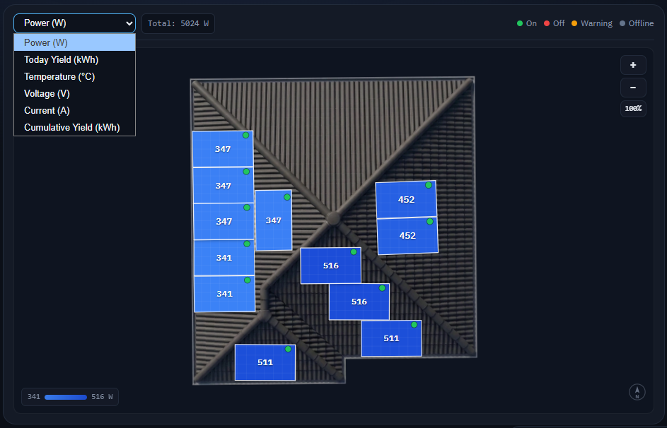
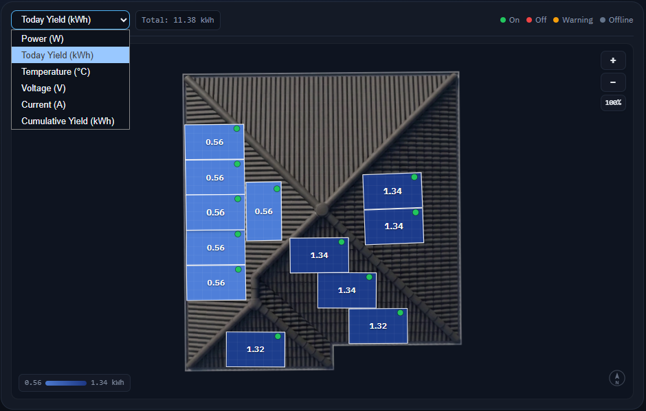
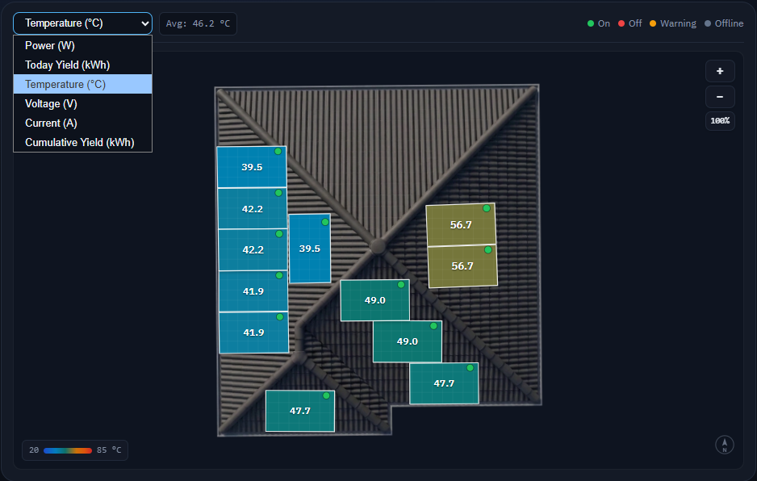
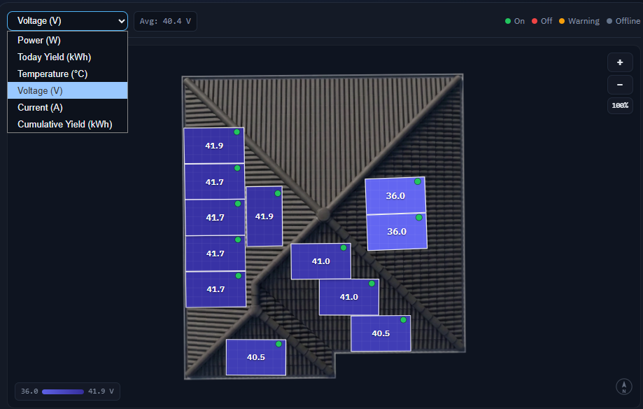
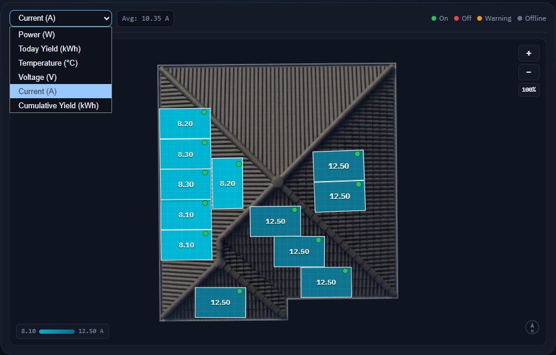
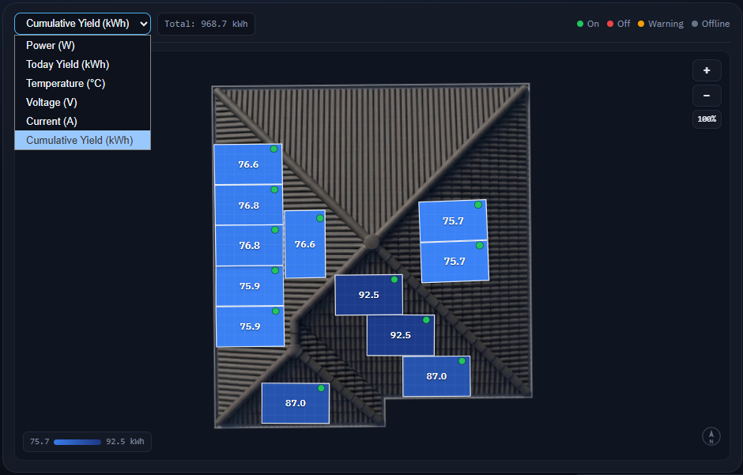

# AndSolar for Home Assistant

Custom integration that shows AndSolar plants, rapid shutdown devices and module optimizers
in Home Assistant, and lets you switch them on and off. It talks to the AndSolar OpenAPI
(`https://ap.andsolartech.com`, production).

<a href="https://my.home-assistant.io/redirect/hacs_repository/?owner=armyjam&repository=andsolar-ha&category=integration" target="_blank" rel="noreferrer"></a>
<a href="https://buymeacoffee.com/armyjam" target="_blank" rel="noreferrer"></a>

> **Unofficial project.** This integration is an independent, community-made project. It is
> **not affiliated with, endorsed by, or supported by AndSolar** or Home Assistant. "AndSolar" and
> any related names or logos are trademarks of their respective owners and are used here only to
> identify the product this integration works with. See [Disclaimer](#disclaimer).

## Requirements

- Home Assistant 2025.2 or newer
- [HACS](https://hacs.xyz) installed in Home Assistant (recommended install method)
- An **AndSolar OpenAPI** username and password, as provided by AndSolar. This is the API
  account, not necessarily the one you use in the AndSolar app or web portal.

## Install with HACS (recommended)

This integration is not in the default HACS store, so you add it once as a custom repository.

1. In Home Assistant open **HACS**. If you have not set HACS up yet, add it first from
   **Settings → Devices & services → Add integration → HACS** and sign in with GitHub.
2. Click the **⋮** menu (top right) and choose **Custom repositories**.
3. Enter the repository URL `https://github.com/armyjam/andsolar-ha`, set **Type** to
   **Integration**, and click **Add**.
   (Or use the "Open in HACS" button at the top of this page.)
4. Find **AndSolar** in HACS and click **Download**.
5. **Restart Home Assistant** (Settings → System → Restart).
6. Go to **Settings → Devices & services → Add integration**, search for **AndSolar** and
   enter your OpenAPI username and password.

The server URL defaults to production (`https://ap.andsolartech.com`). Use
`https://monitor.andsolartech.com` only if AndSolar gave you a test account.

### Updating

HACS shows an update on the AndSolar entry when a new version is published. Click **Update**
and restart Home Assistant afterwards. To see updates before they are released, enable beta
versions in the repository's HACS settings.

### Install manually (without HACS)

Copy the `custom_components/andsolar` folder of this repository into your Home Assistant
`config/custom_components/` folder, restart Home Assistant, then continue with step 6 above.
Manual installs are not updated automatically.

## What you get

One Home Assistant device per plant, and one per rapid shutdown device / module optimizer
(linked to its plant).

| Entity | On | Notes |
|---|---|---|
| Daily energy, Total energy | plant | kWh, usable in the Energy dashboard |
| Power, voltage, current, temperature | device (per branch) | rapid shutdown devices have 1 or 2 branches |
| Output / input voltage and current, PCB / input / output temperature | module optimizer | |
| Daily energy, Total energy | device (per branch) | kWh |
| Status | device (per branch) | offline, warning, accident, healthy |
| Branch output switch | rapid shutdown | real state from the device (`mos`) |
| Output switch | module optimizer | state is assumed from the last command |
| Plant output switch | plant | **disabled by default**; switches the whole plant, state is assumed |

Polling interval defaults to 5 minutes (**Configure** on the integration page, 1 to 60
minutes). Each update makes one request per device, so keep the interval sensible on large
plants. Panel layout polygons (`/module/getViewListNoData`) are cached with topology and
refreshed every 6 hours (or when you reload the integration), so the layout view does not
add extra polling overhead.

## Plant Layout Card

The integration bundles a custom Lovelace card (`custom:andsolar-plant-card`) that renders
your panels using the polygon coordinates configured in AndCloud, shaded by live values
from your Home Assistant entities.

The card is registered automatically when the integration loads — **no separate HACS
frontend download or manual Lovelace resource is required**. After updating, restart Home
Assistant and refresh your browser.

<table>
  <tr>
    <td align="center" valign="top" width="50%">
      
      <br /><sub>Power (W)</sub>
    </td>
    <td align="center" valign="top" width="50%">
      
      <br /><sub>Today Yield (kWh)</sub>
    </td>
  </tr>
  <tr>
    <td align="center" valign="top" width="50%">
      
      <br /><sub>Temperature (°C)</sub>
    </td>
    <td align="center" valign="top" width="50%">
      
      <br /><sub>Voltage (V)</sub>
    </td>
  </tr>
  <tr>
    <td align="center" valign="top" width="50%">
      
      <br /><sub>Current (A)</sub>
    </td>
    <td align="center" valign="top" width="50%">
      
      <br /><sub>Cumulative Yield (kWh)</sub>
    </td>
  </tr>
</table>

### Features

- **Real panel geometry** from AndCloud (`getViewListNoData`), with optional layout rotation.
- **Full-roof background image alignment**: overlay a top-down roof plan or drone photo
  underneath the live panel polygons with interactive scale, X/Y offset, rotation, aspect-ratio
  fit (`meet` / `slice`), and automatic `viewBox` expansion (`background_fit_viewbox`) so empty
  roof slopes and eaves are never clipped.
- **Live metric switching** directly on the card: Today Yield (kWh), Power (W), Current (A),
  Voltage (V), Temperature (°C), and Cumulative Yield (kWh).
- **1:2 / shared optimizer support**: automatically detects panels sharing a single optimizer
  (`shared_device_mode`: `average` per-panel split, `primary` first-panel-only, or `raw`),
  highlights linked partner panels on hover/selection, and prevents double-counting in totals.
- **Fixed thermal temperature scale**: uses a physical color gradient (`temp_min: 20` to
  `temp_max: 85` °C by default) so normal operating temperatures stay calm and only genuinely
  hot panels turn amber/orange/red.
- **Status indicators** on every panel: On (green), Off (red), Warning (amber), Offline (gray).
- **Interactive inspection**: hover tooltip with all metrics, click a panel for the detail
  bar with one-click Home Assistant **History** (More Info) and optional **Turn On / Turn Off**
  output switch control.
- **Zoom & pan**: mouse wheel zoom, drag to pan, touch pinch-to-zoom, double-click to reset,
  and optional `+` / `−` / reset zoom buttons.
- **Dashboard & theme friendly**: optional `fill_height` flex mode for fixed-height grid
  dashboards and CSS custom property hooks (`--andsolar-card-*`, `--andsolar-stage-*`).
- **Visual editor & YAML**: every option is configurable via the Home Assistant Dashboard UI
  or YAML.

### Quick start

Add the **AndSolar Plant Layout** card from the Dashboard Card Picker, or switch to YAML:

```yaml
type: custom:andsolar-plant-card
```

If you only have one plant, `plant_id` is detected automatically.

### Full YAML example

```yaml
type: custom:andsolar-plant-card

# Plant & card header
plant_id: 10494                 # Optional when you have a single plant
title: Roof Solar Layout        # Defaults to the plant name from AndCloud
show_title: false               # Show card title header above the toolbar

# Metrics, 1:2 optimizer display & temperature scale
default_metric: daily_energy    # daily_energy | power | current | voltage | temperature | total_energy
shared_device_mode: average     # average (÷2 for 1:2) | primary (first panel only) | raw
temp_min: 20                    # Cool end of temperature color scale (°C)
temp_max: 85                    # Hot end of temperature color scale (°C)
metrics:                        # Optional subset of metrics shown in the dropdown
  - daily_energy
  - power
  - current
  - voltage
  - temperature
  - total_energy

# Canvas layout
height: 320                     # Canvas height in pixels (140 - 1400)
fill_height: false              # Fill parent container height instead of fixed px height
rotation: 0                     # Clockwise rotation in degrees (-180 to 180)

# Toolbar & canvas display toggles
show_header: true               # Top toolbar (metric selector, summary badge, legend)
show_metric_selector: true      # Metric dropdown
show_summary: true              # Total / Avg badge
show_legend: true               # On / Off / Warning / Offline legend
show_scale: true                # Color gradient scale bar
show_compass: true              # North compass indicator
show_grid: true                 # Background dot grid
show_cell_pattern: true         # Solar cell grid texture on panels

# Per-panel display toggles
show_values: true               # Numeric values centered on each panel
show_unit_on_panel: false       # Append unit after each panel value
show_sn: false                  # Short device SN (+ branch) on each panel
show_status_dot: true           # Status indicator dot in each panel corner

# Interaction & control
show_tooltip: true              # Hover tooltip with all metrics
show_detail_bar: true           # Bottom detail bar when a panel is clicked
show_switch_control: true       # Turn On / Turn Off button in detail bar (false = read-only)
tap_action: select              # select | more-info | none

# Zoom & pan
enable_zoom_pan: true           # Mouse wheel zoom, drag pan, touch pinch-to-zoom
show_zoom_controls: true        # +, −, and 100% reset buttons
min_zoom: 0.5                   # Minimum zoom factor (0.2 - 1)
max_zoom: 6                     # Maximum zoom factor (1 - 20)

# Optional roof background image (place file in config/www/)
background_image: ""            # e.g. /local/roof.jpg
background_opacity: 0.35        # 0 to 1
background_fit: slice           # slice (cover panel bounds) | meet (preserve aspect ratio)
background_scale: 1.0           # Scale multiplier (0.2 - 5.0)
background_offset_x: 0          # Horizontal offset in % of panel bounds (-200 to 200)
background_offset_y: 0          # Vertical offset in % of panel bounds (-200 to 200)
background_rotation: 0          # Rotation in degrees around image center (-180 to 180)
background_fit_viewbox: false   # Expand default viewBox to fit the full background image
```

### Aligning a full-roof background image

When your roof plan or drone photo includes roof slopes without panels (such as an empty north
slope or eaves overhang), use `background_fit: meet` with `background_fit_viewbox: true` and
fine-tune `background_scale`, `background_offset_x`, `background_offset_y`, and
`background_rotation` live in the visual editor:

```yaml
type: custom:andsolar-plant-card
show_grid: false
fill_height: true
background_image: /local/roof-plan.png
background_opacity: 0.55
background_fit: meet
background_scale: 1.45
background_offset_x: 0
background_offset_y: -18
background_rotation: 1.5
background_fit_viewbox: true
```

### Customizing card & canvas styles

Optional CSS custom properties can be set in your Home Assistant theme (or via `card_mod`) to
blend the card into custom dashboards without changing default HA styling:

- `--andsolar-card-bg` (default: `var(--ha-card-background, var(--card-background-color, #fff))`)
- `--andsolar-card-border` (default: HA card border variables)
- `--andsolar-card-radius` (default: `var(--ha-card-border-radius, 12px)`)
- `--andsolar-stage-bg` (default: `var(--secondary-background-color, rgba(127,127,127,0.06))`)
- `--andsolar-stage-border` (default: `1px solid var(--divider-color, rgba(127,127,127,0.2))`)

### Card configuration options

| Option | Type | Default | Description |
|---|---|---|---|
| `plant_id` | integer | auto | AndSolar plant ID. Optional when you have a single plant. |
| `title` | string | plant name | Custom title shown when `show_title: true`. |
| `show_title` | boolean | `false` | Show a card title header above the toolbar. |
| `default_metric` | string | `daily_energy` | Initial metric: `daily_energy`, `power`, `current`, `voltage`, `temperature`, or `total_energy`. |
| `shared_device_mode` | string | `average` | How 1:2 (or 1:N) shared optimizers are displayed: `average` (divides power, energy, and voltage by panel count, e.g. ÷2; keeps current and temperature as-is), `primary` (shows combined actual value on the first panel only and leaves linked partner panels blank), or `raw` (shows the raw device value on every panel). Summary totals never double-count in any mode. |
| `temp_min` | number | `20` | Cool end (°C) of the fixed thermal color scale for the Temperature view. |
| `temp_max` | number | `85` | Hot end (°C) of the fixed thermal color scale for the Temperature view. |
| `metrics` | list | all 6 metrics | Limit which metrics appear in the dropdown selector. |
| `height` | integer | `320` | Canvas height in pixels (`140`–`1400`). Ignored when `fill_height: true`. |
| `fill_height` | boolean | `false` | Fill the parent container's height with a flex layout instead of using a fixed pixel `height`. |
| `rotation` | number | `0` | Rotate the entire layout clockwise in degrees (`-180` to `180`). The North compass rotates with it. |
| `show_header` | boolean | `true` | Show the top toolbar (metric dropdown, summary badge, legend). |
| `show_metric_selector` | boolean | `true` | Show the metric dropdown in the toolbar. |
| `show_summary` | boolean | `true` | Show the total/average summary badge next to the dropdown. |
| `show_legend` | boolean | `true` | Show the On / Off / Warning / Offline legend. |
| `show_scale` | boolean | `true` | Show the min–max color gradient scale bar. |
| `show_compass` | boolean | `true` | Show the North compass indicator. |
| `show_grid` | boolean | `true` | Show the subtle background dot grid. |
| `show_cell_pattern` | boolean | `true` | Show subtle solar cell grid texture on panels. |
| `show_values` | boolean | `true` | Show numeric values centered on each panel. |
| `show_unit_on_panel` | boolean | `false` | Append the unit after the value inside each panel. |
| `show_sn` | boolean | `false` | Show the short device serial number (and branch) on each panel. |
| `show_status_dot` | boolean | `true` | Show the colored status dot in each panel corner. |
| `show_tooltip` | boolean | `true` | Show the hover tooltip with all panel metrics. |
| `show_detail_bar` | boolean | `true` | Show the bottom detail bar when a panel is selected. |
| `show_switch_control` | boolean | `true` | Show the Turn On / Turn Off switch button in the detail bar (set `false` for read-only dashboards). |
| `enable_zoom_pan` | boolean | `true` | Enable mouse wheel zoom, drag to pan, and touch pinch-to-zoom. |
| `show_zoom_controls` | boolean | `true` | Show the `+`, `−`, and reset (`100%`) zoom control buttons on the canvas. |
| `min_zoom` | number | `0.5` | Minimum zoom factor (`0.2`–`1`). |
| `max_zoom` | number | `6` | Maximum zoom factor (`1`–`20`). |
| `tap_action` | string | `select` | What happens when tapping a panel: `select` (show detail bar), `more-info` (open HA entity history dialog), or `none`. |
| `background_image` | string | `""` | Optional image URL (e.g. `/local/roof.jpg`) rendered behind panels. |
| `background_opacity` | number | `0.35` | Opacity of `background_image` (`0`–`1`). |
| `background_fit` | string | `slice` | SVG aspect-ratio fit mode: `slice` (cover panel bounds) or `meet` (preserve natural aspect ratio inside a square scaled to `max(width, height)`). |
| `background_scale` | number | `1.0` | Scale multiplier for `background_image` (`0.2`–`5.0`), centered on panel bounds. |
| `background_offset_x` | number | `0` | Horizontal shift as a percentage of panel bounds width (`-200` to `200`, positive = right). |
| `background_offset_y` | number | `0` | Vertical shift as a percentage of panel bounds height (`-200` to `200`, positive = down). |
| `background_rotation` | number | `0` | Rotation in degrees (`-180` to `180`) around the background image's center. |
| `background_fit_viewbox` | boolean | `false` | Expand the SVG `viewBox` to the union of panels and the transformed background image so overhang/empty roof slopes are not clipped at 100% zoom. |

## Safety

The switches control real power equipment. Turning a rapid shutdown output off stops that
string's output. The plant-wide switch is disabled by default; enable it in the entity settings
only if you want it. Do not wire these switches to automations you have not tested.

Do not rely on this integration for anything safety-critical. Rapid shutdown and optimizer
functions exist to protect people and equipment: confirm their behavior on the device or in the
official AndSolar tools, not only in Home Assistant.

## Troubleshooting

**"Invalid username or password" when adding the integration.** The message is shown for any
login that the server does not accept, not only a wrong password. Check that you are using the
OpenAPI account and that no extra space was added to the fields. To see the server's actual
answer, enable debug logging (below) and try again.

**Debug logging.** Add this to `configuration.yaml`, restart, and look in
**Settings → System → Logs**:

```yaml
logger:
  default: warning
  logs:
    custom_components.andsolar: debug
```

Do not post logs publicly without checking them first.


**Switches take a while to react.** Commands go through the AndSolar cloud. The server may
execute a command before its response reaches Home Assistant, so a switch can briefly show the
old state; it settles on the next update.

**Custom card does not appear after updating.** Restart Home Assistant and hard-refresh your
browser (`Ctrl+Shift+R` / clear cache in the Companion App). If the card says no panel layout
geometry was found, verify that module positions are configured on the Layout page in AndCloud
and reload the AndSolar integration.

## Known caveats

- The OpenAPI docs do not describe every response, so field handling follows the documented
  examples. Unknown or missing values show as unavailable instead of failing the update.
- Optimizer and plant-wide switch states are assumed from the last command, not read back from
  the device.
- Entity names are English only.

## Disclaimer

- **Use at your own risk.** The software is provided "as is", without warranty of any kind. The
  author is not liable for any damage, data loss, loss of generation, or equipment problems
  resulting from its use. This includes the switches, which send real commands to real
  equipment.
- **Not affiliated.** This is not an official AndSolar product. It was built against the AndSolar
  OpenAPI and may stop working if AndSolar changes or withdraws that API.
- **Your account, your responsibility.** Use only an OpenAPI account you are entitled to use, and
  make sure your use complies with the terms that came with it (for example limits on automated
  requests). Keep the polling interval reasonable.
- **Trademarks and images.** Product names, trademarks and logos belong to their respective
  owners. The MIT license below covers the source code only; it does not grant any rights to
  third-party names, logos or images.

## Privacy

Your OpenAPI username and password are stored in your Home Assistant configuration (the
integration's config entry) on your own system. They are sent only to the server URL you
configure (production by default). The integration has no telemetry and sends nothing to the
author. Do not share Home Assistant backups, diagnostics or logs without checking them first.

## Support

If this integration is helpful to you, you can support ongoing development by buying me a coffee:

<a href="https://buymeacoffee.com/armyjam" target="_blank" rel="noreferrer"></a>

## License

Released under the [MIT License](LICENSE). Copyright (c) 2026 armyjam.

## Development

```
custom_components/andsolar/
  api.py          blocking HTTP client (standard library only), token handling
  parsing.py      pure helpers (unit-tested without Home Assistant)
  coordinator.py  polling, topology & layout cache, runs client in executor thread
  config_flow.py  setup, re-authentication and options
  sensor.py       sensors
  switch.py       switches
  websocket.py    WebSocket command (andsolar/get_plant_layout) for the layout card
  frontend.py     static path & extra JS registration for the bundled card
  frontend/       bundled Lovelace card (andsolar-plant-card.js)
  brand/          icon shown in Home Assistant (2026.3 and newer)
tests/            python -m unittest discover -s tests -v
```

The tests cover the client (against a local mock server) and the parsing helpers. They do not
import Home Assistant, so the integration code itself needs a manual check in a real Home
Assistant instance.
